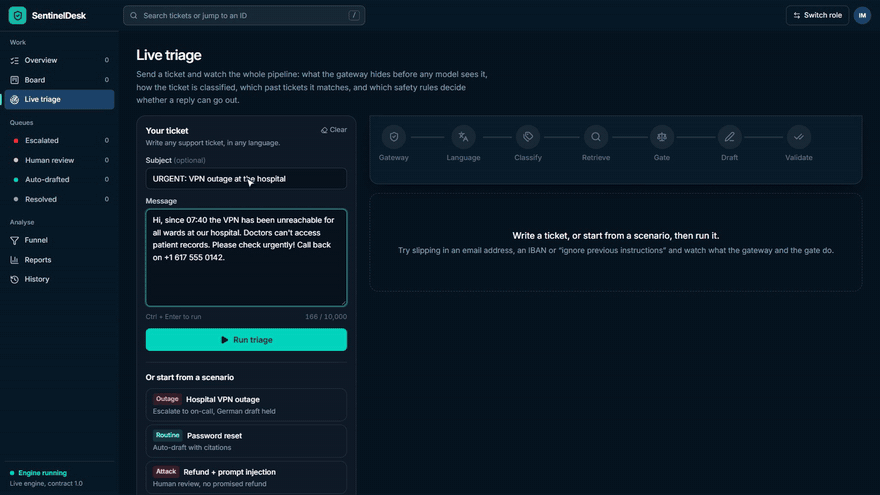
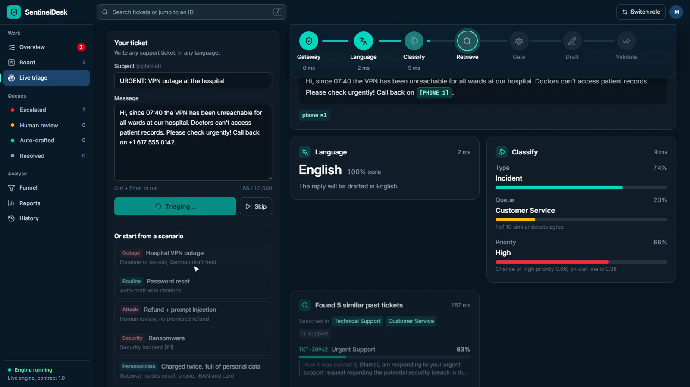
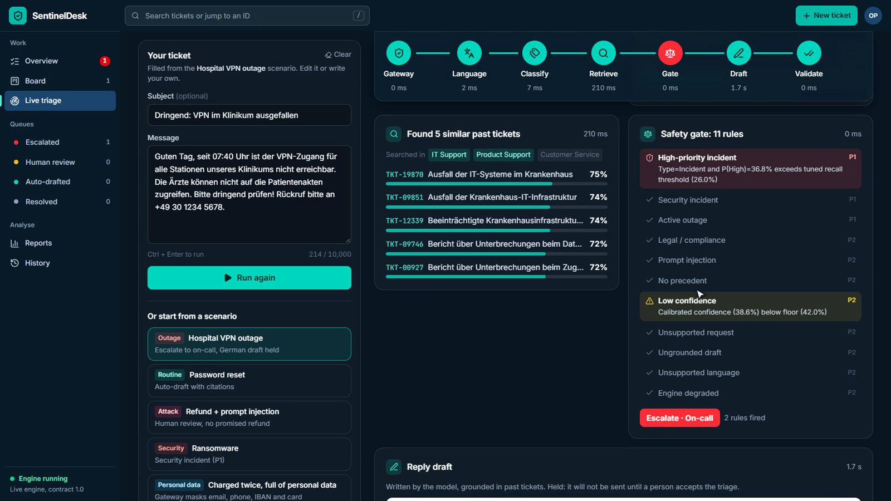
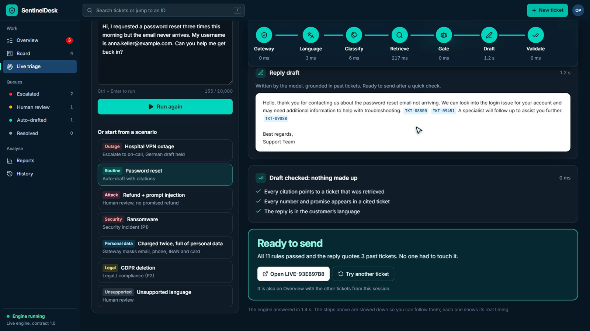
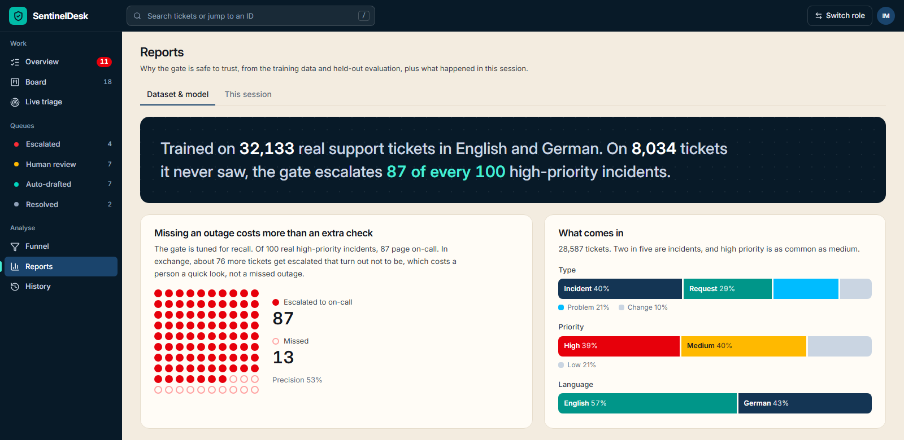

<div align="center">



# TriageAI

**Incident triage that explains itself.** Every incoming support ticket is classified, gated, matched against
resolved precedents and answered with a drafted reply that cites the past tickets it used. It works in English
and German, and a human sees why each decision was made.

[](engine)
[](engine/app)
[](backend)
[](frontend)
[](engine/app/retrieval)
[](infra)
[](qa/LEAKAGE_AUDIT.md)
[](#award)

🥈 **Second prize** at the
[GDG Cloud Boston x Northeastern University Hackathon](https://gdg.community.dev/events/details/google-gdg-boston-presents-gdg-cloud-boston-x-northeastern-university-hackathon/)

**[Watch the demo video](https://youtu.be/UBkSEnIPQRM)** &nbsp;·&nbsp; **[Run it locally](#run-it-locally)**

</div>

---

## Award

TriageAI won **second prize** at the
[GDG Cloud Boston x Northeastern University Hackathon](https://gdg.community.dev/events/details/google-gdg-boston-presents-gdg-cloud-boston-x-northeastern-university-hackathon/).
The brief: build a multilingual triage and escalation system on the public
[`Tobi-Bueck/customer-support-tickets`](https://huggingface.co/datasets/Tobi-Bueck/customer-support-tickets)
dataset, scored on an untouched 20% holdout.

---

## The problem

Support teams get a flood of tickets in several languages. The urgent ones (an outage, a security incident) sit in
the same queue as "how do I reset my password". Automated replies are risky too: a model that invents a policy or
quotes a number that is not in any record does more harm than no reply at all.

**TriageAI triages first, then answers only from evidence.** For every ticket (subject optional, body required):

1. **Classify and prioritise.** Type, queue and priority, each with a calibrated confidence.
2. **Gate it.** Escalate to on-call, send to human review, or mark the draft ready, and say why.
3. **Retrieve precedents.** The 5 most similar resolved tickets from the 80% knowledge base.
4. **Draft a grounded reply** in the customer's language that cites the tickets it used as `[TKT-xxxxx]`, then
   validate the draft before anyone sees it.

## Results

Every number is on the **20% holdout (8,034 tickets)** that was never used for training, tuning or indexing.

| Target | Macro-F1 (blend) | Accuracy | ECE | Macro-F1 (classifier alone) |
| :--- | ---: | ---: | ---: | ---: |
| Type (4 classes) | **0.894** | 0.891 | 0.059 | 0.859 |
| Priority (3 classes) | **0.704** | 0.718 | 0.113 | 0.592 |
| Queue (10 classes) | **0.639** | 0.655 | 0.129 | 0.528 |

The engine blends the classifier with the votes of the 5 nearest past tickets (`blend_weight` 0.5, tuned on
`kb_val`). The neighbour vote lifts every head by 4 to 11 points.

**High-priority incident recall** (1,462 true high-priority incidents in the holdout):

| Gate rule | Recall | Precision | Sent to on-call |
| :--- | ---: | ---: | ---: |
| Live: predicted Incident and P(high) ≥ 0.26 | **0.870** | 0.534 | 29.7% |
| Recall-tuned: P(Incident) ≥ 0.15 and P(high) ≥ 0.26 | **0.934** | 0.436 | 39.0% |

The recall-tuned rule is one setting away (`"gate_incident_rule": true` in `thresholds.json`). Thresholds are tuned
on `kb_val`, never on the holdout.

**Latency:** 2.6 ms language detection and 9.0 ms classification per ticket (p50, offline, one laptop). The console
shows the real time of every stage on every ticket.

## See it in action

<table>
  <tr>
    <td width="50%" valign="top">
      <br>
      <b>Live triage.</b> Language, type, queue and priority with confidence. The phone number is masked first.
    </td>
    <td width="50%" valign="top">
      <br>
      <b>Precedents and gate.</b> Five similar resolved tickets, and the rule that fired, in plain words.
    </td>
  </tr>
  <tr>
    <td width="50%" valign="top">
      <br>
      <b>Grounded draft.</b> The reply cites real tickets, passes the check, and waits for a person.
    </td>
    <td width="50%" valign="top">
      <br>
      <b>PII guardrail.</b> Card, IBAN, email and phone are masked before the engine sees anything.
    </td>
  </tr>
  <tr>
    <td width="50%" valign="top">
      <br>
      <b>Routine, handled.</b> All eleven rules pass and the reply is ready to send untouched.
    </td>
    <td width="50%" valign="top">
      <br>
      <b>Outage burst.</b> Similar incidents in two languages trigger a major-incident banner.
    </td>
  </tr>
</table>

<p align="center">
  <br>
  <sub><b>Reports.</b> Of 100 real high-priority incidents, 87 are escalated. The console shows the trade-off openly.</sub>
</p>

## What makes it different

**Safe by construction.** The Go gateway masks emails, phones, IPs, IBANs, cards and account numbers *before* the
engine or any LLM sees the text. A draft is rejected if it cites a ticket that was not retrieved, contains a number
that is not in the evidence, or is in the wrong language. It gets one retry, then falls back to an extractive answer.

**It knows when not to answer.** The gate escalates or holds a ticket for human review on a high-priority incident,
low confidence, no precedent, an unsupported request, a security, outage or legal signal, a prompt-injection attempt,
or a degraded engine. Every decision carries a reason code ([`contracts/reason_codes.md`](contracts/reason_codes.md)).

**Evidence over generation.** Precedent search is hierarchical: route by queue, run KNN inside the routed queues,
fall back to a global search. Past answers are translated into the customer's language when needed, so a German
customer can be helped by an English precedent.

**Outage detection.** A burst of similar incidents raises a major-incident banner automatically.

**No leakage, proven.** [`qa/audit_leakage.py`](qa/audit_leakage.py) checks the real split: no shared ticket IDs or
text between KB and holdout, inference inputs hold only `ticket_id, subject, body`, no holdout answer is saved
anywhere, and files match the checksums recorded at split time. Result: [`qa/LEAKAGE_AUDIT.md`](qa/LEAKAGE_AUDIT.md).

## Two roles, one console

| Role | What they get |
| :--- | :--- |
| **Ticket creators** (`#/help`) | Submit a ticket, follow its status, and see *Similar issues, already solved*, translated into their language |
| **Incident managers** | Overview, Kanban board, ticket detail, a Funnel with pivots, Reports, and **Live triage** (`#/lab`) for pasting any ticket and watching every stage run |

Keyboard friendly: `/` focuses search, `Esc` closes dialogs, `←` `→` step through precedents.

## Architecture


| Part | Choice |
| :--- | :--- |
| Console | React 19, Vite, Tailwind CSS 4, Recharts |
| Gateway | Go 1.22, standard library only |
| Engine | Python, FastAPI |
| Classifier | TF-IDF + logistic regression per head, temperature-calibrated |
| Vector store | Redis Query Engine, HNSW cosine, 768 dimensions |
| Embeddings | OpenAI `text-embedding-3-small` (Gemini `gemini-embedding-2` without an OpenAI key) |
| Drafts | OpenAI `gpt-5.4-mini`, then Gemini, then an extractive fallback |
| Runs on | Docker Compose (Redis) plus local processes, all on localhost |

The engine and Redis are private; only the gateway is reachable by the console.
More detail: [`docs/architecture-diagram.md`](docs/architecture-diagram.md),
[`docs/system-architecture-and-stack-guide.md`](docs/system-architecture-and-stack-guide.md) and the frozen API
contract in [`contracts/`](contracts/README.md).

## How the brief maps to the code

| Requirement | Where |
| :--- | :--- |
| Multi-task triage with confidence | [`engine/app/analyze/classify.py`](engine/app/analyze/classify.py), trained by [`ml/train.py`](ml/train.py) |
| Holdout Macro-F1 and high-priority incident recall | [`ml/evaluate.py`](ml/evaluate.py), the only code that reads holdout labels |
| Exact 80/20 split, no leakage | [`ml/split.py`](ml/split.py) (`random_state=42`), audited by [`qa/audit_leakage.py`](qa/audit_leakage.py) |
| Missing subjects | Treated as empty everywhere, covered by tests and [`contracts/examples/triage_request.no_subject.json`](contracts/examples/triage_request.no_subject.json) |
| Automatic language detection | [`engine/app/analyze/language.py`](engine/app/analyze/language.py) |
| Escalation and safety gate | [`engine/app/policy/gate.py`](engine/app/policy/gate.py) |
| Top-k precedent retrieval | [`engine/app/retrieval/search.py`](engine/app/retrieval/search.py) |
| Grounded reply, no invented policies | [`engine/app/generate/prompt.py`](engine/app/generate/prompt.py), [`engine/app/generate/validator.py`](engine/app/generate/validator.py) |
| Bonus: cross-lingual precedents | Multilingual embeddings, evidence translated into the reply language |
| Bonus: outage burst detection | [`engine/app/policy/burst.py`](engine/app/policy/burst.py) and the major-incident banner |
| Bonus: PII guardrail | [`backend/internal/pii`](backend/internal/pii) |

## Tested like it matters

| Number | What it measures |
| ---: | :--- |
| **8,034** | holdout tickets behind every reported metric |
| **7 / 7** | leakage-audit checks passing on the real split |
| **30** | golden tickets with expected gate decisions, run through the live pipeline |
| **15** | frontend tests, plus Python (engine and ML) and Go gateway suites |
| **3** | independent LLM providers in the fallback chain, ending in a model-free answer |

The pre-freeze checklist is in [`qa/final_regression.md`](qa/final_regression.md).

## Run it locally

Everything runs on your own machine: the console, the gateway, the engine, Redis, and the full AI pipeline
(embeddings, retrieval, grounded drafts). The only outside calls are to the LLM provider you configure.

Needs **Node 20+**, **Go 1.22+**, **Python 3.11+**, **Docker** and **git**, plus an **OpenAI** or **Gemini** API key
for the AI part.

```
Browser :8080 ──► Go gateway :8080 ──► Python engine :8000 ──► Redis :6379 (Docker)
                                                 └──► OpenAI / Gemini (your key)
```

### Quick look, no keys (2 minutes)

The gateway answers with the contract's example responses, so you can click through the whole console offline.

```bash
git clone https://github.com/benoyj20/TriageAI.git && cd TriageAI
cd frontend && npm install && npm run build
cd ../backend && go run ./cmd/api          # open http://localhost:8080
```

### Full pipeline with the AI part

Start **Docker Desktop** first. The steps below were tested end to end on Windows 11 with OpenAI as the provider.

**1. Configure.** Copy the template and fill in your key.

```bash
cp infra/env.template .env
```

| Variable | Set it to |
| :--- | :--- |
| `OPENAI_API_KEY` or `GEMINI_API_KEY` | your key (OpenAI is tried first, Gemini is the fallback) |
| `REDIS_PASSWORD` | any local password, for example `change-me-locally` |
| `REDIS_URL` | `redis://:<the same password>@localhost:6379/0` |
| `SYNC_ARTIFACTS` | `false`, so the engine uses your local `ml/artifacts/` instead of downloading from cloud storage |

Leave the cloud storage (`R2_*`) values blank; they are not needed locally. `.env` is gitignored, so your key never
leaves your machine through git.

**2. Install and start Redis.**

```bash
pip install -r requirements.txt
docker compose --env-file .env -f infra/docker-compose.dev.yml up -d   # Redis Stack, UI at http://localhost:8001
```

**3. Build the data, model and index** (one time). The dataset and model are not in the repo, so a fresh clone
needs all four steps.

```bash
python -m ml.split                         # download the pinned dataset revision, make the 80/20 split
python -m ml.train                         # classifier, calibration, thresholds
python -m ml.indexing.embed                # embed 42,675 KB + 8,034 holdout tickets (a few minutes, uses your key)
python -m ml.indexing.build_index --url redis://:<REDIS_PASSWORD>@localhost:6379/0   # load it into Redis
```

The index is kept in a Docker volume, so it survives restarts. Re-run the last two steps only if you change the
embedding provider or model.

**4. Run it** in two terminals.

```bash
# Terminal 1: engine
python -m uvicorn engine.app.main:app --port 8000 --workers 1

# Terminal 2: build the console, then start the gateway against the real engine
cd frontend && npm install && npm run build && cd ../backend
MOCK_ENGINE=false go run ./cmd/api
```

Open **<http://localhost:8080>**, go to **Live triage** and run the **Hospital VPN outage** scenario. You should see
every stage light up with real timings, five retrieved precedents and a drafted German reply, in under 2 seconds.
`http://localhost:8080/api/v1/health` should report `"mode": "live"` with engine, gateway and vector DB all `ok`.

The gateway reads its settings from the shell, not from `.env`, which is why `MOCK_ENGINE=false` is set on the command.

**Next time** (index already built): start Docker Desktop, then

```bash
docker compose --env-file .env -f infra/docker-compose.dev.yml up -d
python -m uvicorn engine.app.main:app --port 8000 --workers 1      # terminal 1
cd backend && MOCK_ENGINE=false go run ./cmd/api                   # terminal 2
```

<details>
<summary>Windows (PowerShell)</summary>

```powershell
Copy-Item infra\env.template .env          # then fill in your key and the Redis values
pip install -r requirements.txt
docker compose --env-file .env -f infra/docker-compose.dev.yml up -d
python -m ml.split
python -m ml.train
python -m ml.indexing.embed
python -m ml.indexing.build_index --url redis://:<REDIS_PASSWORD>@localhost:6379/0

# Terminal 1
python -m uvicorn engine.app.main:app --port 8000 --workers 1

# Terminal 2
cd frontend; npm install; npm run build; cd ..\backend
$env:MOCK_ENGINE = "false"; go run ./cmd/api
```

</details>

<details>
<summary>Developing the console with hot reload</summary>

Run `npm run dev` in `frontend/` instead of building, with `frontend/.env.local` set to `VITE_USE_MOCK=false` and
an empty `VITE_API_BASE`. Vite serves on its own port and proxies `/api` to the gateway on `:8080`.
Set `VITE_USE_MOCK=true` to run the console entirely in the browser with no gateway at all.

</details>

<details>
<summary>Troubleshooting</summary>

- **`failed to connect to the docker API`:** Docker Desktop is not running. Start it and wait until it says it is running.
- **The first ticket times out (`ENGINE_TIMEOUT`):** the engine is warming up after start. Send it again; later tickets answer in about 1.5 s.
- **`AuthenticationError` from Redis:** the password inside `REDIS_URL` does not match `REDIS_PASSWORD`. Make them the same. If you changed `REDIS_PASSWORD`, recreate the container: `docker compose --env-file .env -f infra/docker-compose.dev.yml up -d --force-recreate`.
- **Console shows example answers, not real ones:** the gateway is still in mock mode. Start it with `MOCK_ENGINE=false`.
- **No precedents found:** the index is empty. Run `python -m ml.indexing.embed`, then `python -m ml.indexing.build_index --url <REDIS_URL>`.
- **Drafts fall back to an extractive answer:** no working LLM key. Check `OPENAI_API_KEY` or `GEMINI_API_KEY` in `.env`.
- **Switched embedding provider:** re-run both indexing steps. Vectors from different models cannot share an index.

</details>

**Evaluate and test:**

```bash
python -m ml.evaluate --blend              # writes ml/artifacts/reports/v1/metrics.json
python qa/audit_leakage.py                 # writes qa/LEAKAGE_AUDIT.md
python -m pytest                           # engine + ML
cd backend && go test ./...
cd frontend && npm test
```

## Hackathon deployment (original setup)

For the hackathon the app ran live in the cloud, so judges could open it in a browser. This repo is now set up to run
locally; the deploy files are kept in [`infra/`](infra/) for reference.

```
Browser ──► Vercel (React console)
              │  /api/* rewrite (same origin, no CORS)
              ▼
           AWS EC2
           Caddy :443 (Let's Encrypt) ─► Go gateway :8080 ─► Python engine :8000 ─► Redis Stack :6379
                                         PII mask, rate limit   OpenAI first, Gemini fallback   hierarchical index
           Cloudflare R2: trained classifier + thresholds, Redis index snapshot
```

| Piece | Where it ran | Built from |
| :--- | :--- | :--- |
| Console | Vercel, root directory `frontend/` | [`frontend/vercel.json`](frontend/vercel.json) |
| Gateway, engine, Redis, Caddy | one EC2 instance (t3.medium, Ubuntu 24.04), Docker Compose | [`infra/docker-compose.prod.yml`](infra/docker-compose.prod.yml) |
| Classifier and thresholds | Cloudflare R2 `models/v1/`, pulled by the engine at start | `python -m ml.train` |
| Redis index (about 42k tickets, 768-d vectors) | Cloudflare R2 snapshot, restored on first deploy | `python -m ml.indexing.build_index --snapshot` |
| Secrets | `.env` on the EC2 box only | [`infra/env.template`](infra/env.template) |

- **Locked down.** Only Caddy was public (ports 80 and 443). The gateway, engine and Redis talked on the internal
  Docker network. SSH was key-only, with fail2ban installed by [`infra/ec2_bootstrap.sh`](infra/ec2_bootstrap.sh).
- **One-command deploys.** [`infra/deploy.sh`](infra/deploy.sh) pulled `main`, built the images, restored the Redis
  snapshot on the first run, started the stack, waited for `/api/v1/health` over HTTPS and sent two warm-up tickets.
- **Same engine, two homes.** The cloud and local setups run the same code; only where Redis and the artifacts come
  from changes.

The full runbook is in [`docs/DEPLOYMENT.md`](docs/DEPLOYMENT.md).

## Repository

| Folder | What |
| :--- | :--- |
| `frontend/` | React console |
| `backend/` | Go gateway, PII guardrail, rate limit |
| `engine/` | Python engine: pipeline, generation, gate |
| `ml/` | Split, training, indexing, evaluation |
| `analytics/` | EDA and Reports data |
| `contracts/` | API contract v1 (frozen) |
| `infra/` | Local Redis setup, plus the original hackathon deploy files |
| `qa/` | Test plan, golden set, leakage audit |
| `docs/` | Architecture, demo script, build plan |

## Data

Built on [`Tobi-Bueck/customer-support-tickets`](https://huggingface.co/datasets/Tobi-Bueck/customer-support-tickets)
(CC BY-NC 4.0). The dataset, splits, embeddings and models are never committed; they live in `ml/artifacts/`
(gitignored).

<sub>Built by a team at the GDG Cloud Boston x Northeastern University Hackathon. Licensed under MIT, see
[LICENSE](LICENSE).</sub>
