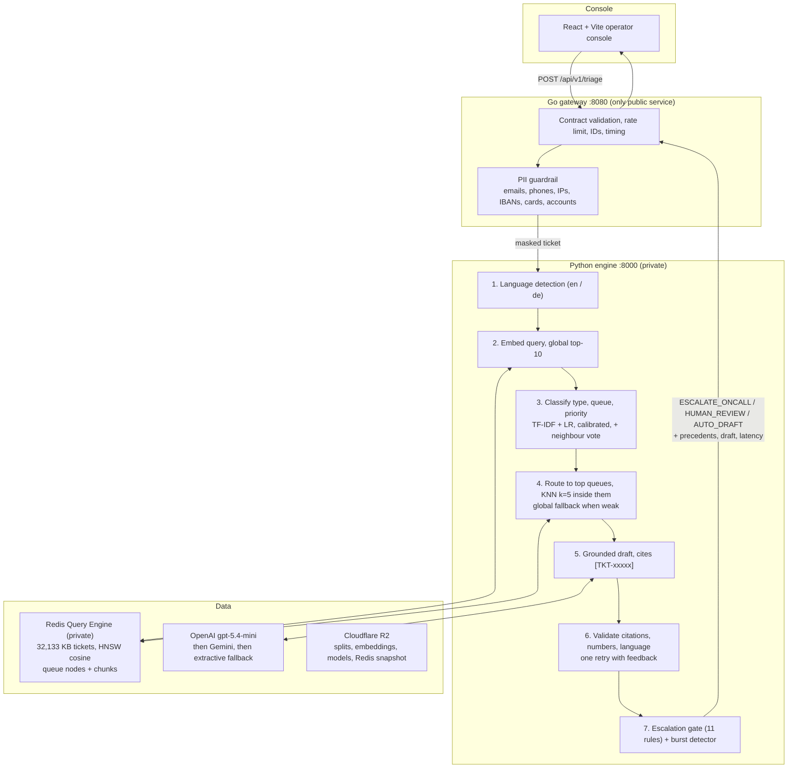
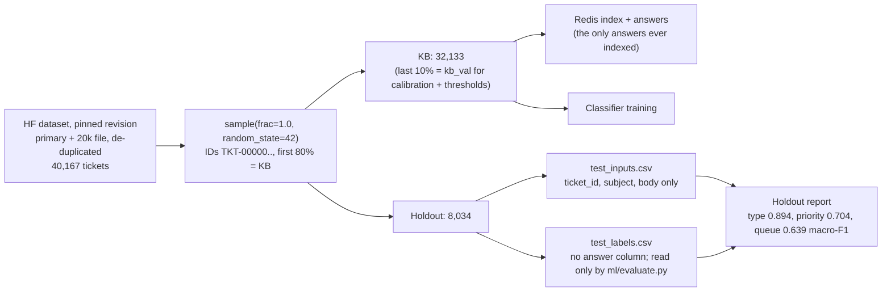
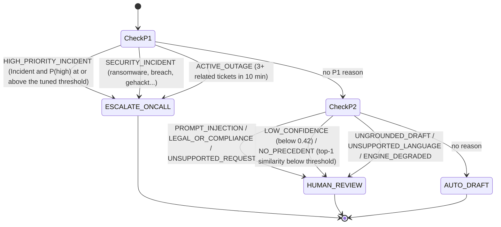

# DA-11: SentinelDesk architecture diagrams

**Owner:** Data Analyst. Numbers come from `python -m ml.evaluate` and `qa/audit_leakage.py`; see the root README.

---

## 1. End-to-end system

The draft is always produced, then held when the gate decides on a person: on-call escalation and human review never send it.

---

## 2. Data split and leakage controls (ML-03, QA-09)

---

## 3. Escalation gate (DA-06, DA-07)

Any P1 reason → `ESCALATE_ONCALL`. Otherwise any P2 reason → `HUMAN_REVIEW`. No reasons → `AUTO_DRAFT`. All reasons are returned.

---

## 4. Demo outline

The full script is [`demo-script.md`](demo-script.md).

| Time | Segment | On screen |
|---|---|---|
| 0:00-0:30 | Problem and architecture | Overview |
| 0:30-1:30 | German hospital VPN outage → on-call, German draft held | Live triage |
| 1:30-2:20 | English password reset → grounded auto-draft | Live triage |
| 2:20-3:00 | Refund + prompt injection → human review, nothing promised | Live triage |
| 3:00-3:30 | Simulate an outage → major-incident banner | Overview |
| 3:30-4:30 | Holdout metrics, leakage audit | Reports |
| 4:30-5:00 | Safeguards and close | |
