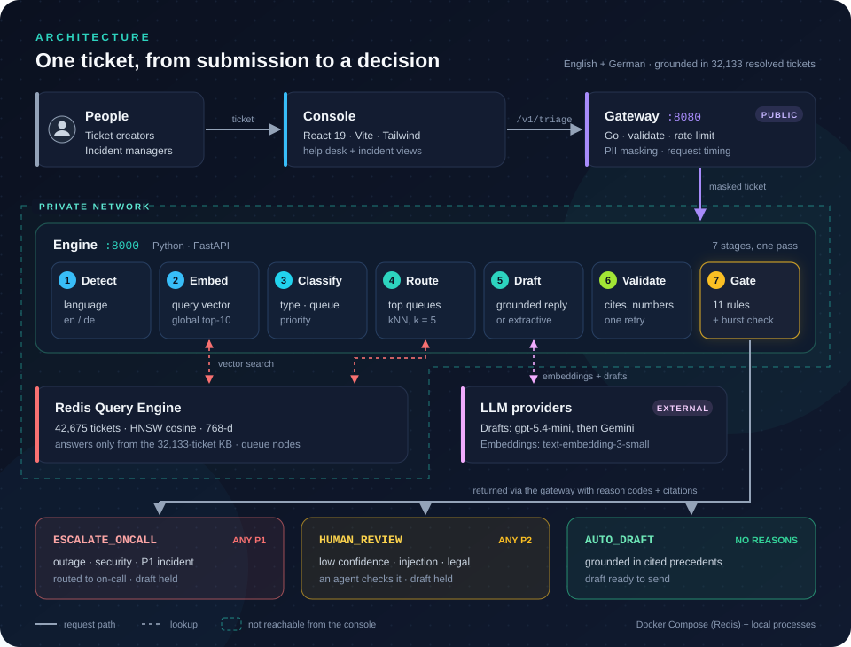
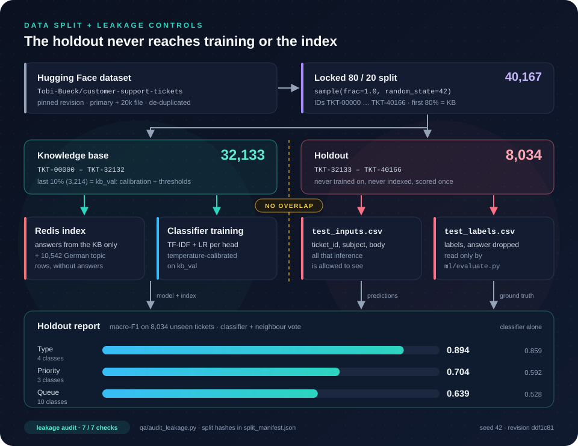
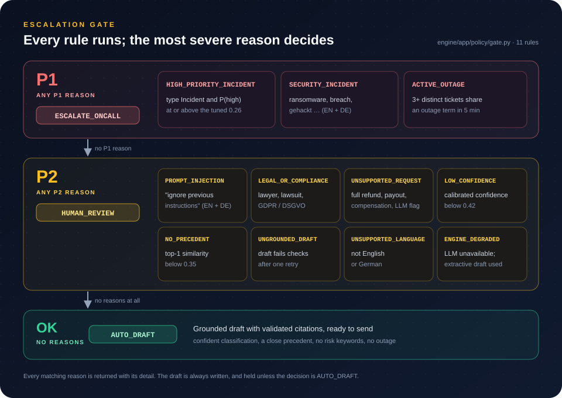

# DA-11: TriageAI architecture diagrams

**Owner:** Data Analyst. Numbers come from `python -m ml.evaluate` and `qa/audit_leakage.py`; see the root README.

---

## 1. End-to-end system

  

| Stage | What it does | Code |
| :--- | :--- | :--- |
| Gateway | Validates the request against contract v1, rate-limits per client, masks emails, phones, IPs, IBANs, cards and account numbers, adds a request ID and timing. 12 s engine timeout. | [`backend/internal/`](../backend/internal) |
| 1. Detect | Language detection (langdetect + stopword fallback). Only `en` and `de` are supported. | [`engine/app/analyze/language.py`](../engine/app/analyze/language.py) |
| 2. Embed | Embeds the ticket once and runs an unfiltered global top-10 search in Redis. | [`engine/app/stages_live.py`](../engine/app/stages_live.py) |
| 3. Classify | TF-IDF + logistic regression per head (type, queue, priority), temperature-calibrated, blended 50/50 with a similarity-weighted vote over the global top-10. | [`engine/app/analyze/classify.py`](../engine/app/analyze/classify.py) |
| 4. Route | Scores queues (75% classifier probability, 25% queue-centroid similarity), runs kNN (k = 5) inside the top 2 queues. Falls back to the global top 5 when the routed top-1 trails the global top-1 by more than 0.05. | [`engine/app/retrieval/search.py`](../engine/app/retrieval/search.py) |
| 5. Draft | Grounded reply that cites `[TKT-xxxxx]`. OpenAI `gpt-5.4-mini`, then Gemini; an extractive draft if both fail; a holding reply (no LLM call) when there are no precedents. | [`engine/app/generate/llm.py`](../engine/app/generate/llm.py) |
| 6. Validate | Checks citations, numbers and language; one retry with the issues fed back. | [`engine/app/generate/validator.py`](../engine/app/generate/validator.py) |
| 7. Gate | 11 rules plus the outage burst detector; see section 3. | [`engine/app/policy/gate.py`](../engine/app/policy/gate.py) |

Redis holds 42,675 tickets: the 32,133-ticket KB (the only answers ever indexed) plus 10,542 German topic rows
without answers, and one node per queue. Embeddings come from a single provider per index
(OpenAI `text-embedding-3-small` at 768 dimensions, or Gemini `gemini-embedding-2` without an OpenAI key); only drafts
fail over between providers.

The draft is always produced, then held when the gate decides on a person: on-call escalation and human review never send it.

In the hackathon deployment, Cloudflare R2 held the trained classifier, its thresholds and a Redis snapshot; running
locally does not need it.

---

## 2. Data split and leakage controls (ML-03, QA-09)

  

The split, row counts and file hashes are recorded in `ml/artifacts/splits/v1/split_manifest.json`
([`ml/split.py`](../ml/split.py)). The leakage audit is [`qa/LEAKAGE_AUDIT.md`](../qa/LEAKAGE_AUDIT.md).

---

## 3. Escalation gate (DA-06, DA-07)

  

Where the thresholds come from:

| Threshold | Value | Source |
| :--- | :--- | :--- |
| P(high) for `HIGH_PRIORITY_INCIDENT` | 0.26 | `priority_high_threshold` in the model's `thresholds.json`, tuned for 0.9 recall on `kb_val` |
| `LOW_CONFIDENCE` floor | 0.42 | gate default ([`gate.py`](../engine/app/policy/gate.py)) |
| `NO_PRECEDENT` top-1 similarity | 0.35 | `no_precedent_threshold`, default in [`stages_live.py`](../engine/app/stages_live.py) |
| `ACTIVE_OUTAGE` burst | 3 distinct tickets in 5 min | `BURST_MIN_TICKETS` / `BURST_WINDOW_S` ([`burst.py`](../engine/app/policy/burst.py)) |

Reason codes and their wording are frozen in [`contracts/reason_codes.md`](../contracts/reason_codes.md).

---

## 4. Demo outline

The full script is [`demo-script.md`](demo-script.md).

| Time | Segment | On screen |
|---|---|---|
| 0:00-0:30 | Problem and architecture | Overview |
| 0:30-1:30 | German hospital VPN outage → on-call, German draft held | Live triage |
| 1:30-2:20 | English password reset → grounded auto-draft | Live triage |
| 2:20-3:00 | Refund + prompt injection → human review, nothing promised | Live triage |
| 3:00-3:30 | Simulate an outage → major-incident banner | Overview |
| 3:30-4:30 | Holdout metrics, leakage audit | Reports |
| 4:30-5:00 | Safeguards and close | |
