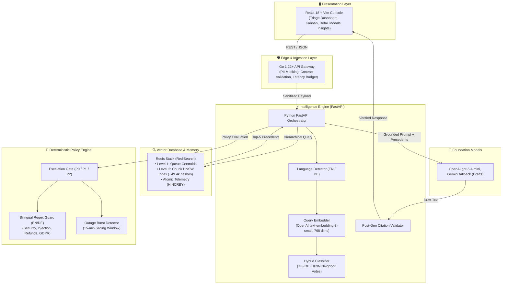

# SentinelDesk: Complete System Architecture, Tech Stack & Process Guide

## 1. Executive Summary

**SentinelDesk** is an autonomous, multilingual (EN/DE) incident triage, deterministic escalation gate, and precedent-grounded resolution copilot built for customer support operations and IT incident management.

When high-volume customer and IT support tickets arrive:
1. **Sanitizes & Masks**: Strips PII at the edge before model processing.
2. **Classifies & Routes**: Predicts priority, queue, and category using hybrid ML.
3. **Retrieves Precedents**: Uses **Hierarchical RAG** over Redis RediSearch HNSW to find verified historical solutions.
4. **Enforces Deterministic Gates**: Applies hardcoded policy rules (security vulnerabilities, prompt injection, GDPR, mass outage bursts) that LLMs cannot bypass.
5. **Generates Grounded Drafts**: Drafts replies with an LLM (OpenAI `gpt-5.4-mini`, Gemini as fallback) with strict ticket ID citations (`[TKT-xxxxx]`), routing P1 emergencies to on-call teams and low-risk tickets to automated dispatch.

---

## 2. Architecture & System Flow

---

## 3. Core Components & Tech Stack Breakdown

### A. Frontend (Operator Console)
* **Stack**: React 18, Vite (JavaScript), Tailwind CSS, Recharts, Lucide Icons.
* **Role**: Real-time interface for support agents, team leads, and incident commanders.
* **Key Modules**:
  * **Triage Dashboard (`TriageDashboard.jsx`)**: Filterable stream of incoming tickets with SLA countdowns, language badges (`EN` / `DE`), and priority flags.
  * **Kanban Board (`KanbanBoard.jsx`)**: Operational status pipeline (`New` ➔ `Triage` ➔ `Investigating` ➔ `Escalated` ➔ `Resolved`).
  * **Ticket Detail & Draft Studio (`TicketDetail.jsx`)**: Split-pane view showing customer request, grounded AI draft, precedent citation links (`[TKT-xxxxx]`), and policy badges.
  * **Executive Insights Tab (`InsightsTab.jsx`)**: Data Analyst telemetry dashboard displaying historical dataset distributions (28,587 tickets), queue bottlenecks, priority breakdowns, and model evaluation benchmarks.

### B. API Gateway (Edge Defense)
* **Stack**: Go 1.22+ (Standard library `net/http` `ServeMux`).
* **Role**: High-throughput gateway shielding internal Python services from raw internet traffic.
* **Key Responsibilities**:
  * **PII Masking**: Redacts customer credit card numbers, IBANs, email addresses, and phone numbers before downstream propagation.
  * **Contract Validation**: Validates schema compliance against API specs; immediately drops malformed payloads.
  * **Latency Budgeting**: Enforces a strict < 2,000 ms end-to-end response budget.

### C. Backend Intelligence Engine
* **Stack**: Python 3.11+, FastAPI, Pydantic, Uvicorn.
* **Role**: Central orchestrator coordinating language detection, classification, retrieval, policy evaluation, and generation.
* **Key Responsibilities**:
  * **Language Detection**: Dynamically routes English and German tickets to specialized prompt templates and regex checks.
  * **Hybrid Classifier**: Combines linear models (TF-IDF + Logistic Regression) with semantic KNN neighbor votes to compute queue confidence.
  * **Citation Auditing**: Post-generation verification pass ensuring every `[TKT-xxxxx]` cited by the LLM was present in the retrieved context.

### D. Vector Database (Hierarchical RAG)
* **Stack**: Redis Stack with RediSearch (`redis/redis-stack` Docker container).
* **Embeddings**: OpenAI `text-embedding-3-small` at 768 dimensions (Google `gemini-embedding-2` when there is no OpenAI key). One provider per index.
* **Role**: Stores ~49,400 ticket chunks with HNSW vector graphs and metadata TAG fields (`queue`, `language`, `priority`, `type`).
* **Why Redis?**:
  1. **Sub-15ms Latency**: Entire HNSW graph resides in-memory on EC2.
  2. **Filtered Vector Search**: Combines cosine distance with exact metadata filters in a single query (`@queue:{Technical\ Support} @language:{de}`).
  3. **Atomic Telemetry**: Tracks precedent frequency via `HINCRBY chunk:<id> queried_count 1` without database locking.
* **Hierarchical Retrieval Flow**:
  1. **Level 1 (Queue Routing)**: Scores queues by blending classifier probability (60%) with queue centroid cosine similarity (40%).
  2. **Level 2 (Chunk Search)**: Executes Redis KNN search restricted to the top routed queues (`k = 5`).
  3. **Global Fallback**: If Level 1 top-1 similarity falls below threshold, falls back to a global top-10 search to prevent misses.

### E. Safety & Policy Gate (Data Analyst Layer)
* **Stack**: Pure Python (`re`, `datetime`, `collections.deque`).
* **Role**: Deterministic security and operational escalation gate. LLMs can hallucinate; deterministic rules cannot.
* **Gate Architecture**:
  * **`ESCALATE_ONCALL` (P1)**: Critical service outages, active security breaches, prompt injection attempts, or burst spikes. Bypasses automated replies and pages human on-call engineers.
  * **`HUMAN_REVIEW` (P2)**: GDPR data deletion requests, billing disputes, unsupported financial refunds, or tickets with `NO_PRECEDENT`.
  * **`AUTO_DRAFT` (P0)**: Routine, low-risk requests (e.g., password reset, known configuration errors) backed by high-confidence historical precedents.
* **Bilingual Regex Guardrail (`keywords.py`)**:
  * Compiles regex patterns covering Security/Injection, Prompt Injection, Financial/Crypto, and Legal/GDPR across German and English.
* **Outage Burst Detector (`burst.py`)**:
  * Sliding 15-minute rolling window tracking ticket velocity. If ≥ 3 outage tickets target the same component, fires `ACTIVE_OUTAGE`.

### F. Data & Analytics Foundation
* **Dataset**: `Tobi-Bueck/customer-support-tickets` (**28,587 verified tickets**; 57.2% EN, 42.8% DE).
* **Role**: Authoritative ground truth establishing priority distributions, queue SLAs, and holdout evaluation sets.
* **Telemetry Mirrors**:
  * `analytics/insights/operations_insights.json` & `frontend/src/features/insights/data/operations_insights.json`
  * `analytics/insights/model_insights.json` & `frontend/src/features/insights/data/model_insights.json`

### G. Foundation Models (Generation)
* **Model**: OpenAI `gpt-5.4-mini` first, then Google `gemini-3.1-flash-lite`, then an extractive fallback that quotes the best precedent.
* **Role**: Generates accurate, empathetic draft resolutions grounded in retrieved precedent answers.
* **System Contract**:
  * Draft must cite precedent tickets (`[TKT-xxxxx]`).
  * If context does not contain the answer, explicitly return `NO_PRECEDENT` rather than guessing.

---

## 4. End-to-End Processing Lifecycle

| Step | Component | Action | Output / SLA |
| :--- | :--- | :--- | :--- |
| **1. Ingest** | Go Gateway | Ingests ticket JSON; strips PII (emails, cards, SSNs) | Clean payload (< 10ms) |
| **2. Embed** | Python Engine | Converts text into 768-d float32 vector via the configured embedding model | Dense vector |
| **3. Classify** | ML Engine | Blends TF-IDF with vector neighbor votes for queue probabilities | Top-2 Queue Routes |
| **4. Retrieve** | Redis RediSearch | Level-1 centroid check ➔ Level-2 HNSW KNN search (`k=5`) | 5 Precedent Chunks (< 15ms) |
| **5. Gate** | Policy Engine | Evaluates regex rules + 15-min rolling window outage bursts | Gate Code (`P0` / `P1` / `P2`) |
| **6. Draft** | LLM (OpenAI, then Gemini) | Writes the reply from the precedent answers only | Grounded draft |
| **7. Verify** | Engine Validator | Scans draft for valid `[TKT-xxxxx]` citations against context | Hallucination Check Passed |
| **8. Present** | React Console | Renders ticket, policy badge, and actionable draft for operator | Total Latency < 1,500ms |

---

## 5. Architectural Trade-offs & Rationale

1. **Why Hierarchical RAG instead of Flat Search?**
   * *Problem*: In a flat 50,000-chunk index, cross-queue semantic noise causes IT infrastructure tickets to retrieve irrelevant billing answers.
   * *Solution*: Routing to queue centroids first cuts the search space by ~80%, increasing precedent relevance and precision.
2. **Why Redis over External Cloud Vector DBs (Pinecone/Weaviate)?**
   * *Problem*: Cloud vector databases add 80–150ms HTTP network round-trips and external vendor dependencies.
   * *Solution*: Self-hosted Redis Stack in Docker on EC2 runs in-memory with sub-15ms latency, supports atomic `HINCRBY` counters, and backups cleanly via RDB snapshots.
3. **Why Deterministic Gate + LLM (Defense in Depth)?**
   * *Problem*: Adversarial users use prompt injection to trick LLMs into issuing unauthorized refunds or ignoring security policies.
   * *Solution*: Deterministic regex and policy logic runs *outside* the LLM context, guaranteeing that high-risk requests are routed to humans regardless of model persuasion.
