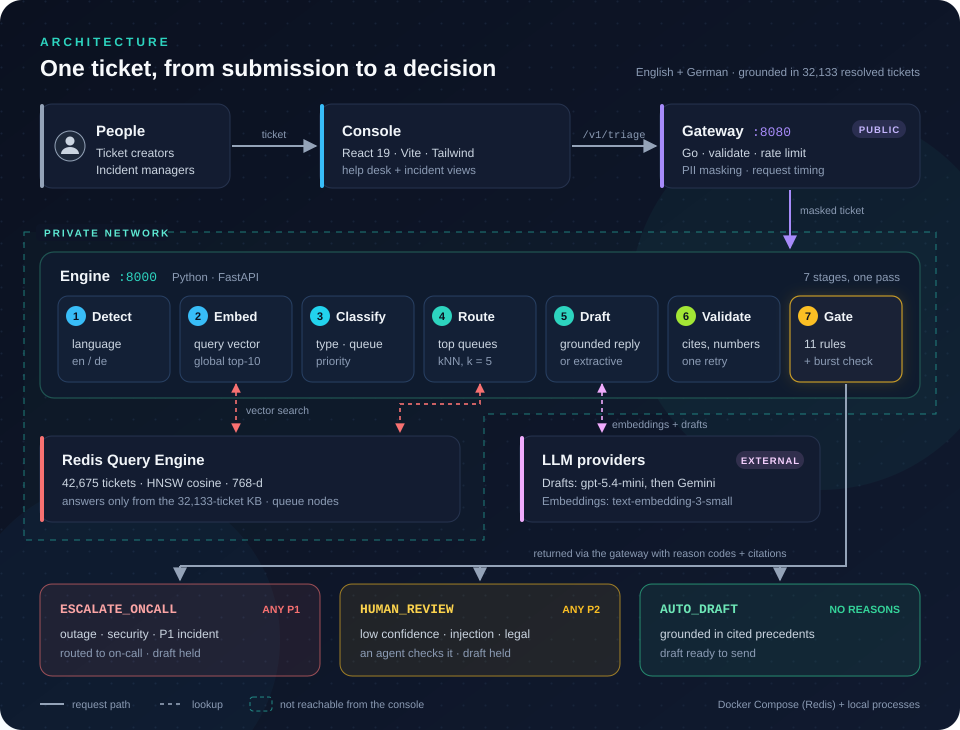

# TriageAI: Complete System Architecture, Tech Stack & Process Guide

## 1. Executive Summary

**TriageAI** is an autonomous, multilingual (EN/DE) incident triage, deterministic escalation gate, and precedent-grounded resolution copilot built for customer support operations and IT incident management.

When high-volume customer and IT support tickets arrive:
1. **Sanitizes & Masks**: Strips PII at the edge before model processing.
2. **Classifies & Routes**: Predicts priority, queue, and category using hybrid ML.
3. **Retrieves Precedents**: Uses **Hierarchical RAG** over Redis RediSearch HNSW to find verified historical solutions.
4. **Enforces Deterministic Gates**: Applies hardcoded policy rules (security vulnerabilities, prompt injection, GDPR, mass outage bursts) that LLMs cannot bypass.
5. **Generates Grounded Drafts**: Drafts replies with an LLM (OpenAI `gpt-5.4-mini`, Gemini as fallback) with strict ticket ID citations (`[TKT-xxxxx]`), routing P1 emergencies to on-call teams and low-risk tickets to automated dispatch.

---

## 2. Architecture & System Flow

  

The engine runs its stages in this order: language → embed + global top-10 → classify → route + search → draft →
validate → gate. The gate runs last because it needs the validator's grounding result, and the response goes back to
the console through the gateway. Stage-by-stage detail and the data split and gate diagrams are in
[`architecture-diagram.md`](architecture-diagram.md).

---

## 3. Core Components & Tech Stack Breakdown

### A. Frontend (Operator Console)
* **Stack**: React 19, Vite (JavaScript), Tailwind CSS 4, Recharts, Lucide Icons.
* **Role**: Real-time interface for support agents, team leads, and incident commanders.
* **Key Modules**:
  * **Triage Dashboard (`TriageDashboard.jsx`)**: Filterable stream of incoming tickets with SLA countdowns, language badges (`EN` / `DE`), and priority flags.
  * **Kanban Board (`KanbanBoard.jsx`)**: Operational status pipeline (`New` ➔ `Triage` ➔ `Investigating` ➔ `Escalated` ➔ `Resolved`).
  * **Ticket Detail & Draft Studio (`TicketDetail.jsx`)**: Split-pane view showing customer request, grounded AI draft, precedent citation links (`[TKT-xxxxx]`), and policy badges.
  * **Executive Insights Tab (`InsightsTab.jsx`)**: Data Analyst telemetry dashboard displaying historical dataset distributions (28,587 tickets), queue bottlenecks, priority breakdowns, and model evaluation benchmarks.

### B. API Gateway (Edge Defense)
* **Stack**: Go 1.22+ (Standard library `net/http` `ServeMux`).
* **Role**: High-throughput gateway shielding internal Python services from raw internet traffic.
* **Key Responsibilities**:
  * **PII Masking**: Replaces email addresses, phone numbers, IP addresses, IBANs, card numbers and account numbers with placeholders before the ticket reaches the engine.
  * **Contract Validation**: Validates requests against the contract v1 schema; rejects invalid JSON with 400 `INVALID_JSON` and schema violations with 422 `VALIDATION_ERROR`.
  * **Rate Limiting**: Limits triage requests per client and returns 429 `RATE_LIMITED` when exceeded.
  * **Request IDs and Timing**: Adds `X-Request-ID` and measures gateway and engine time. The engine call times out after 12 s.

### C. Backend Intelligence Engine
* **Stack**: Python 3.11+, FastAPI, Pydantic, Uvicorn.
* **Role**: Central orchestrator coordinating language detection, classification, retrieval, policy evaluation, and generation.
* **Key Responsibilities**:
  * **Language Detection**: Dynamically routes English and German tickets to specialized prompt templates and regex checks.
  * **Hybrid Classifier**: Combines linear models (TF-IDF + Logistic Regression) with semantic KNN neighbor votes to compute queue confidence.
  * **Citation Auditing**: Post-generation verification pass ensuring every `[TKT-xxxxx]` cited by the LLM was present in the retrieved context.

### D. Vector Database (Hierarchical RAG)
* **Stack**: Redis Stack with RediSearch (`redis/redis-stack` Docker container).
* **Embeddings**: OpenAI `text-embedding-3-small` at 768 dimensions (Google `gemini-embedding-2` when there is no OpenAI key). One provider per index.
* **Role**: Stores 42,675 ticket chunks (the 32,133-ticket KB, the only answers indexed, plus 10,542 German topic rows without answers) with an HNSW vector index and metadata TAG fields (`queue`, `language`, `priority`, `type`), and one node per queue.
* **Why Redis?**:
  1. **In-memory Latency**: The whole HNSW graph lives in memory.
  2. **Filtered Vector Search**: Combines cosine distance with exact metadata filters in a single query (`@queue:{Technical\ Support} @language:{de}`).
  3. **Atomic Telemetry**: `HINCRBY chunk:<id> queried_count 1` can track precedent frequency without locks (`retrieve(count=True)`); the live triage path leaves it off.
* **Hierarchical Retrieval Flow**:
  1. **Global Search**: The query is embedded once and an unfiltered top-10 search runs first; the classifier uses these neighbours for its vote.
  2. **Level 1 (Queue Routing)**: Scores queues by blending classifier probability (75%, tuned `route_alpha`; 60% without a tuned model) with queue centroid cosine similarity.
  3. **Level 2 (Chunk Search)**: Executes Redis KNN search restricted to the top 2 routed queues (`k = 5`).
  4. **Global Fallback**: If the routed top-1 similarity trails the global top-1 by more than 0.05, the global top 5 is used instead.

### E. Safety & Policy Gate (Data Analyst Layer)
* **Stack**: Pure Python (`re`, `datetime`, `collections.deque`).
* **Role**: Deterministic security and operational escalation gate. LLMs can hallucinate; deterministic rules cannot.
* **Gate Architecture** (all 11 rules run; every matching reason is returned):
  * **`ESCALATE_ONCALL`**: any P1 reason: `HIGH_PRIORITY_INCIDENT` (type Incident and P(high) at or above the tuned threshold), `SECURITY_INCIDENT` (ransomware, breach, gehackt...) or `ACTIVE_OUTAGE` (burst). The draft is held for the on-call engineer.
  * **`HUMAN_REVIEW`**: otherwise any P2 reason: `PROMPT_INJECTION`, `LEGAL_OR_COMPLIANCE`, `UNSUPPORTED_REQUEST` (refunds, payouts, compensation), `LOW_CONFIDENCE`, `NO_PRECEDENT`, `UNGROUNDED_DRAFT`, `UNSUPPORTED_LANGUAGE` or `ENGINE_DEGRADED`. The draft is held for an agent.
  * **`AUTO_DRAFT`**: no reasons at all: a confident classification, a close precedent and a draft that passed validation.
* **Bilingual Regex Guardrail (`keywords.py`)**:
  * Compiles regex patterns for security incidents, prompt injection, unsupported financial requests and legal/GDPR terms in German and English.
* **Outage Burst Detector (`burst.py`)**:
  * Rolling 5-minute window (`BURST_WINDOW_S`). When 3 or more distinct tickets (`BURST_MIN_TICKETS`) share an outage term, it fires `ACTIVE_OUTAGE`. Demo tickets (`SIM-`, `TEST-`, `WARMUP-`) use a separate window.

### F. Data & Analytics Foundation
* **Dataset**: `Tobi-Bueck/customer-support-tickets` (**28,587 verified tickets**; 57.2% EN, 42.8% DE).
* **Role**: Authoritative ground truth establishing priority distributions, queue SLAs, and holdout evaluation sets.
* **Telemetry Mirrors**:
  * `analytics/insights/operations_insights.json` & `frontend/src/features/insights/data/operations_insights.json`
  * `analytics/insights/model_insights.json` & `frontend/src/features/insights/data/model_insights.json`

### G. Foundation Models (Generation)
* **Model**: OpenAI `gpt-5.4-mini` first, then Google `gemini-3.1-flash-lite`, then an extractive fallback that quotes the best precedent.
* **Role**: Generates accurate, empathetic draft resolutions grounded in retrieved precedent answers.
* **System Contract**:
  * Draft must cite precedent tickets (`[TKT-xxxxx]`), and every number in it must appear in the evidence or the ticket.
  * With no precedents, the engine writes a holding reply without calling the LLM. `NO_PRECEDENT` is a gate reason, raised when the top-1 similarity is below the threshold.

---

## 4. End-to-End Processing Lifecycle

| Step | Component | Action | Output / SLA |
| :--- | :--- | :--- | :--- |
| **1. Ingest** | Go Gateway | Validates the ticket JSON, rate-limits, masks PII (emails, phones, IPs, IBANs, cards, account numbers) | Masked payload |
| **2. Detect** | Python Engine | Detects the language; only English and German are supported | `en` / `de` |
| **3. Embed** | Python Engine | Converts text into a 768-d vector and runs a global top-10 search | Query vector + neighbours |
| **4. Classify** | ML Engine | TF-IDF + logistic regression per head, blended 50/50 with the neighbours' vote | Type, queue, priority with confidence |
| **5. Retrieve** | Redis Query Engine | Level-1 queue routing ➔ Level-2 HNSW KNN in the top 2 queues (`k=5`), global fallback | 5 precedents |
| **6. Draft** | LLM (OpenAI, then Gemini) | Writes the reply from the precedent answers only; extractive draft if both fail | Grounded draft |
| **7. Validate** | Engine Validator | Checks citations, numbers and language; one retry with feedback | Pass / fail per check |
| **8. Gate** | Policy Engine | 11 rules + 5-minute outage burst window | `ESCALATE_ONCALL` / `HUMAN_REVIEW` / `AUTO_DRAFT` + reasons |
| **9. Present** | React Console | Renders ticket, decision, reasons and draft, via the gateway | Per-stage latency in the response |

---

## 5. Architectural Trade-offs & Rationale

1. **Why Hierarchical RAG instead of Flat Search?**
   * *Problem*: In a flat 50,000-chunk index, cross-queue semantic noise causes IT infrastructure tickets to retrieve irrelevant billing answers.
   * *Solution*: Routing to queue centroids first cuts the search space by ~80%, increasing precedent relevance and precision.
2. **Why Redis over External Cloud Vector DBs (Pinecone/Weaviate)?**
   * *Problem*: Cloud vector databases add 80–150ms HTTP network round-trips and external vendor dependencies.
   * *Solution*: Self-hosted Redis in Docker (on EC2 for the hackathon, localhost now) runs in memory, supports atomic `HINCRBY` counters, and backs up cleanly via RDB snapshots.
3. **Why Deterministic Gate + LLM (Defense in Depth)?**
   * *Problem*: Adversarial users use prompt injection to trick LLMs into issuing unauthorized refunds or ignoring security policies.
   * *Solution*: Deterministic regex and policy logic runs *outside* the LLM context, guaranteeing that high-risk requests are routed to humans regardless of model persuasion.
